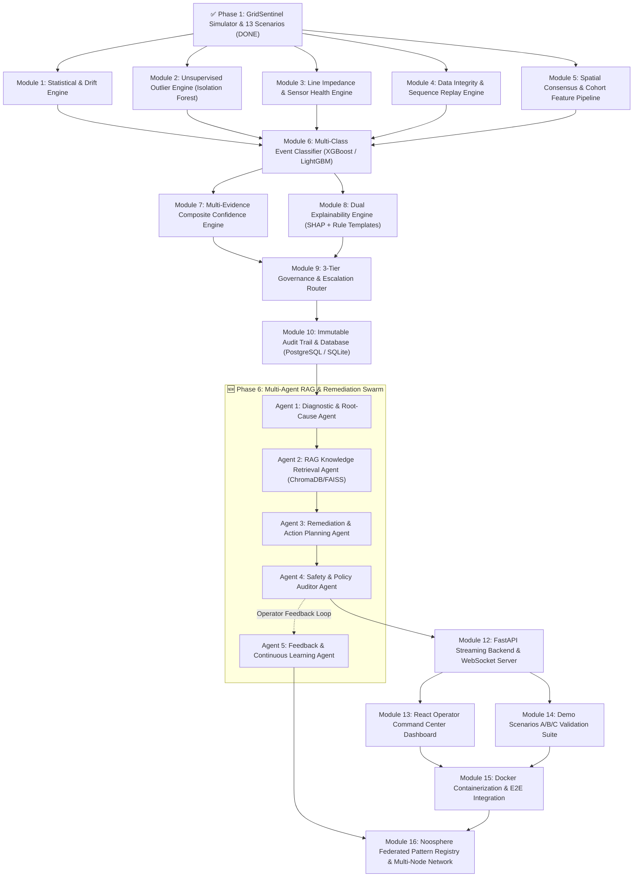
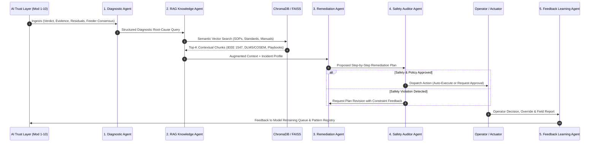

# EnergyMind Tunisia — Master Execution Plan & Architecture

> **Comprehensive Module-Ordered Build Plan** for the AI Trust Layer, Multi-Agent Remediation Swarm, and Federated Noosphere.
> Each module is listed in strict dependency order — a module can only begin once all its prerequisites are satisfied.

---

## Architecture & Dependency Map

---

## ✅ Phase 1: GridSentinel Simulator & Telemetry Engine — COMPLETE

> Implemented, verified, and committed in `src/gridsentinel/simulator.py` and `data/generated/`.

| Artifact / Component | Location | Description |
|---|---|---|
| **Simulation Core** | `src/gridsentinel/simulator.py` | Multi-day 1-minute smart meter generator for 30 households |
| **Physics Model** | `BUILDING_DISTANCES_M` & `CABLE_RESISTANCE_PER_M` | Dynamic radial feeder voltage drop ($50\text{m} \to 600\text{m}$, $\Delta V = R \cdot d \cdot I$) |
| **13-Scenario Problem Engine** | `METER_SCENARIOS` in `simulator.py` | Complete injection coverage across all 4 challenge categories |
| **Ground-Truth Event Registry** | `data/generated/labels.csv` | 13+ timestamped episodes with parameter JSON and severity |
| **Baseline Normal Training Data** | `data/generated/normal_training.csv` | 43,200 rows of clean baseline (multi-day diurnal + weekend profiles) |
| **Scored Demonstration Dataset** | `data/generated/scored_demo.csv` | 43,200 rows with 27 telemetry, feature, verdict, and explanation columns |
| **Validation Test Suite** | `tests/test_prototype.py` | 4 test suites verifying determinism, columns, Scenario A, and Scenario C |

### The 13 Injected Anomaly Scenarios Catalogued

| # | Scenario Name | Category | Real-World Mechanism |
|---|---|---|---|
| 1 | `consumption_spike` | Demand Event | $2.0\times\text{–}3.2\times$ power surge; dynamic voltage sag coupled to wire resistance |
| 2 | `meter_drift` | Data Quality | Gradual progressive linear drift ($+0.6\text{ to }+1.2\text{ kW}$) in power channel |
| 3 | `constant_bias` | Data Quality | Static persistent active power offset ($+0.8\text{ to }+1.5\text{ kW}$) |
| 4 | `false_data_injection` | Falsification | Active power scaled by $0.45\times$ or $1.85\times$ while current remains unchanged |
| 5 | `replay_like` | Falsification | Temporal replay of 4-point historical measurement vector from earlier quiet hours |
| 6 | `frozen_meter` | Data Integrity | Sensor memory crash: all channels hold static floating-point value ($\sigma^2 = 0$) |
| 7 | `missing_data` | Comms Loss | Telemetry packet loss: active power values replaced with `NaN` |
| 8 | `energy_power_mismatch` | Data Quality | Accumulation register inconsistency: $P \times \Delta t \neq \Delta E_{\text{kwh}}$ |
| 9 | `random_corruption` | Data Integrity | Out-of-bounds corruption: $999.0\text{V}$, $-15.0\text{V}$, or impossible $PF = 1.85$ |
| 10 | `dropout` | Comms Loss | Complete telemetry collapse: $V = 0.0$, $I = 0.0$, $P = 0.0$ |
| 11 | `bias_injection` | Electricity Theft | Proportional stealth theft: $35\%$ scaling down of both power and current ($0.65\times$) |
| 12 | `equipment_fault` | Real Event | Inductive equipment breakdown: $2.2\times$ current surge with power factor drop to $0.55$ |
| 13 | `grid_event` | Real Event | Feeder-wide grid disturbance: simultaneous $18\text{V}$ sag across **all 10 meters** on feeder |

---

## Phase 2: Feature Engineering & Detection Engines (Modules 1–5)

> Builds upon the baseline logic established in `src/gridsentinel/detector.py`. These 5 modules can be developed in parallel.

---

### Module 1: Statistical Outlier & Drift Engine

**Directory:** `src/gridsentinel/detectors/statistical/`

| | Details |
|---|---|
| **Purpose** | Detect transient impulses, accumulated sensor bias, and progressive calibration drift using classical statistical tracking |
| **Tech Stack** | Python, NumPy, SciPy, pandas |
| **Algorithms** | Rolling Z-score, Exponentially Weighted Moving Average (EWMA), CUSUM, Page-Hinkley test |
| **Prerequisites** | Phase 1 complete |

| Input | Output |
|---|---|
| `data/generated/normal_training.csv` (calibrating normal statistical limits) | Per-row scores: `z_score_voltage`, `z_score_power`, `ewma_drift_score` |
| Telemetry columns: `voltage_v`, `current_a`, `active_power_kw` | Binary alert flags: `statistical_spike_alert`, `sustained_drift_flag` |
| Rolling residuals from Module 5 | Drift rate parameter ($\Delta V / \text{min}$ or $\Delta P / \text{min}$) |

---

### Module 2: Unsupervised Outlier Engine (Isolation Forest)

**Directory:** `src/gridsentinel/detectors/unsupervised/`

| | Details |
|---|---|
| **Purpose** | Detect multivariate, non-linear anomalies without relying on ground-truth anomaly labels |
| **Tech Stack** | scikit-learn (`IsolationForest`), `StandardScaler`, `SimpleImputer`, `joblib` |
| **Model Config** | 160 estimators, contamination $\approx 0.03$, trained on clean normal multi-day baselines |
| **Prerequisites** | Phase 1 complete |

| Input | Output |
|---|---|
| `normal_training.csv` (features: residuals, ratios, raw electrical channels) | Continuous decision function score: `normality_score` |
| Streaming/batch feature vectors from Module 5 | Normalized anomaly score: `anomaly_score` $\in [0.0, 1.0]$ |
| Contamination quantile threshold | Binary flag: `ml_anomaly` (True/False) |
| Serialized artifact: `models/isolation_forest.joblib` | Outlier tree depth distribution for explainability |

---

### Module 3: Line Impedance & Sensor Health Engine

**Directory:** `src/gridsentinel/detectors/sensor_health/`

| | Details |
|---|---|
| **Purpose** | Track physical wire drop consistency and per-sensor degradation/health indices (0–100) |
| **Tech Stack** | Python, NumPy, pandas |
| **Physics Formula** | Expected line drop: $V_{\text{expected}} = 230.0 - (R_{\text{cable}} \times \text{distance} \times I)$ |
| **Prerequisites** | Phase 1 complete |

| Input | Output |
|---|---|
| `distance_from_transformer_m` & `current_a` | Feature: `voltage_consistency_residual` |
| `voltage_v` | Per-sensor rolling Health Score (0–100): `sensor_health_index` |
| Historical baseline mean per meter | Metric: `impedance_deviation_index` (flags localized wire/connector faults) |

---

### Module 4: Data Integrity & Sequence Replay Engine

**Directory:** `src/gridsentinel/detectors/integrity/`

| | Details |
|---|---|
| **Purpose** | Catch frozen telemetry, out-of-bounds corruptions, and multi-channel replay attacks |
| **Tech Stack** | Python, NumPy, sliding-window hashing / autocorrelation |
| **Algorithms** | Zero-variance run length, physical boundary assertions, 4-point electrical vector entropy signature matching |
| **Prerequisites** | Phase 1 complete |

| Input | Output |
|---|---|
| Measurement vector: `[V, I, P, PF, Hz, kWh]` | Binary flags: `is_frozen`, `is_corrupted`, `is_replay` |
| Historical rolling buffer (sliding window $> 20$ min) | Replay collision flag: `replay_sequence_flag` |
| Physics limits ($V \in [180, 270]$, $PF \in [0.70, 1.0]$, $I \ge 0$) | Out-of-bounds metadata: `oob_channel`, `oob_value` |

---

### Module 5: Spatial Consensus & Cohort Feature Pipeline

**Directory:** `src/gridsentinel/features/`

| | Details |
|---|---|
| **Purpose** | Refactor and standardize spatial feeder consensus, peer cohort ratios, and physics residuals into a reusable pipeline class |
| **Tech Stack** | Python, pandas, NumPy, Pydantic |
| **Key Features** | `feeder_sag_ratio`, `feeder_median_voltage`, `cohort_power_ratio`, `rolling_power_residual`, `rolling_energy_residual` |
| **Prerequisites** | Phase 1 complete |

| Input | Output |
|---|---|
| Raw streaming or batch telemetry DataFrame | Fully engineered feature matrix with spatial and cohort metrics |
| Grouping keys: `feeder_id`, `household_type`, `building_id` | Streaming-ready single-tick transformer method `.transform_tick(buffer)` |

---

## Phase 3: Evidence Fusion & Event Classification (Module 6)

---

### Module 6: Supervised Multi-Class Event Classifier

**Directory:** `src/gridsentinel/classifier/`

| | Details |
|---|---|
| **Purpose** | Fuse evidence from Modules 1–5 into an accurate multi-class event classifier capable of distinguishing grid crises from sensor faults and cyberattacks |
| **Tech Stack** | XGBoost (primary), LightGBM, scikit-learn |
| **Target Classes** | `NORMAL`, `GENUINE_GRID_EVENT`, `DATA_QUALITY_ISSUE`, `FALSIFICATION_ATTACK`, `EQUIPMENT_FAULT` |
| **Prerequisites** | **Modules 1, 2, 3, 4, 5** complete |

| Input | Output |
|---|---|
| Engineered feature matrix (Modules 1–5) | Predicted `event_class` label |
| Ground-truth targets from `data/generated/labels.csv` | Class probability vector (5 classes) |
| Feeder consensus ratio (`feeder_sag_ratio`) | Feature importance ranking |
| Training/Validation/Test split data | Serialized model: `models/event_classifier_xgb.joblib` |

---

## Phase 4: Trust Layer & Explainability (Modules 7–8)

---

### Module 7: Multi-Evidence Composite Confidence Engine

**Directory:** `src/gridsentinel/trust/confidence/`

| | Details |
|---|---|
| **Purpose** | Calculate an inspectable, calibrated composite confidence score ($0.0\text{–}1.0$) using multi-evidence fusion rather than an uncalibrated raw softmax |
| **Tech Stack** | Python, NumPy |
| **Formula** | $C = w_1 P(\text{class}) + w_2 (\text{Consensus Ratio}) + w_3 (\text{Detector Agreement}) + w_4 (\text{Sensor Health}) + w_5 (\text{Residual Magnitude})$ |
| **Prerequisites** | **Module 6** complete |

| Input | Output |
|---|---|
| Model class probability (Module 6) | `composite_confidence` score (e.g. 0.94) |
| Feeder consensus ratio (Module 5) | `confidence_breakdown` dictionary |
| Detection engines agreement count (Modules 1–4) | Confidence level indicator: `HIGH` ($\ge 0.95$), `MEDIUM` ($0.70\text{–}0.95$), `LOW` ($< 0.70$) |
| Sensor Health Index (Module 3) | Score calibration metadata for audit log |

---

### Module 8: Dual Explainability Engine (SHAP + Rule Templates)

**Directory:** `src/gridsentinel/trust/explainability/`

| | Details |
|---|---|
| **Purpose** | Generate dual-layer explainability: local SHAP feature attributions for data scientists and natural-language justifications for grid operators |
| **Tech Stack** | SHAP (`TreeExplainer`), Jinja2 rule templates |
| **Prerequisites** | **Module 6** complete |

| Input | Output |
|---|---|
| Trained XGBoost model (Module 6) | SHAP feature attributions per prediction |
| Classified feature instance | Top-3 contributing physical features |
| Event category & triggered evidence codes | Natural-language `explanation` string for operator display |
| Contextual metadata (feeder consensus, meter distance) | Force-plot visualization JSON for React frontend |

---

## Phase 5: Governance, Escalation & Audit Trail (Modules 9–10)

---

### Module 9: 3-Tier Governance & Escalation Router

**Directory:** `src/gridsentinel/governance/`

| | Details |
|---|---|
| **Purpose** | Route each classified event into a strict, non-hardcoded 3-tier operational escalation path with human override capabilities |
| **Tech Stack** | Python, YAML configuration (`config/governance.yaml`) |
| **Tiers** | `AUTO_ACTION` ($\ge 0.95$ & low risk), `OPERATOR_APPROVAL` ($0.70\text{–}0.95$), `HUMAN_INVESTIGATION` ($< 0.70$ or novel outlier) |
| **Prerequisites** | **Modules 7 & 8** complete |

| Input | Output |
|---|---|
| `event_class` (Module 6) | Assigned `escalation_tier` |
| `composite_confidence` (Module 7) | `assigned_role` (e.g. *Substation Automated Dispatch Controller*) |
| `explanation` (Module 8) | Operational routing ticket with SLA countdown |
| Configurable threshold rules from YAML | Operator override interface methods: `approve()`, `override()`, `reject()` |

---

### Module 10: Immutable Audit Trail & Database

**Directory:** `src/gridsentinel/db/`

| | Details |
|---|---|
| **Purpose** | Maintain an append-only, searchable compliance database recording every event, SHAP explanation, confidence breakdown, and operator intervention |
| **Tech Stack** | SQLite (prototype) / PostgreSQL (production), SQLAlchemy ORM, Alembic |
| **Prerequisites** | **Module 9** complete |

| Input | Output |
|---|---|
| Routed governance records from Module 9 | Persisted audit table entries (`audit_id`, `timestamp`, `event_id`, `verdict`, `confidence`, `assigned_role`, `operator_action`, `status`) |
| Operator overrides and feedback annotations | Exportable compliance reports (`audit_log.csv`) |
| Model version tracking | Query API for historical audit search and filtering |

---

## 🆕 Phase 6: Multi-Agent RAG & Autonomous Remediation Swarm (Module 11)

> An intelligent multi-agent collaborative swarm that transforms raw anomaly detections into validated, safety-audited operational remediation plans.
> Designed with an **abstract Orchestrator Interface** supporting either a **LangGraph StateGraph** or a **Native Async FastAPI / Pydantic pipeline**.

---

### Module 11a: Agent 1 — Diagnostic & Root-Cause Agent

| | Details |
|---|---|
| **Role** | Ingests multi-signal telemetry, SHAP values, and spatial consensus to synthesize an accurate root-cause diagnosis |
| **Inputs** | `event_class`, `verdict`, `evidence`, `voltage_consistency_residual`, `feeder_sag_ratio`, `sensor_health_index` |
| **Outputs** | Structured Diagnostic Report (JSON): Root cause probability, affected equipment, failure mode, and search keywords for RAG |
| **LLM Engine** | LiteLLM client (configurable between Google Gemini, OpenAI, Claude, or local Ollama / Llama-3) |

---

### Module 11b: Agent 2 — RAG Knowledge Retrieval Agent

| | Details |
|---|---|
| **Role** | Retrieves exact utility playbooks, equipment manuals, and grid codes matching the diagnosis from an embedded vector database |
| **Tech Stack** | Embedded **ChromaDB** or **FAISS** (runs locally in-process without requiring external database containers) |
| **Knowledge Base** | <ul><li>**Grid Standards:** IEEE 1547 (interconnection), IEC 61850 (substation automation), STEG Low-Voltage Grid Code ($\pm 10\%$)</li><li>**Hardware Specs:** Smart meter maintenance guides, DLMS/COSEM optical calibration manuals, distribution transformer limits</li><li>**Utility SOPs:** Feeder voltage sag recovery playbook, smart meter tampering investigation, communication outage triage</li></ul> |
| **Outputs** | Contextual document snippets with exact section and page references |

---

### Module 11c: Agent 3 — Remediation & Action Planning Agent

| | Details |
|---|---|
| **Role** | Synthesizes a concrete, step-by-step operational remediation plan based on retrieved playbooks and the specific incident parameters |
| **Inputs** | Diagnostic report (Agent 1) + Retrieved SOP chunks (Agent 2) |
| **Outputs** | Structured Remediation Plan: <ul><li>Immediate mitigation (e.g. remote soft-reset, virtual sensor substitution)</li><li>Field action (e.g. dispatch technician with calibration tool, inspect line tap)</li><li>Administrative action (e.g. flag billing account, quarantine cryptographic session)</li><li>Estimated resolution time & required operator authority</li></ul> |

---

### Module 11d: Agent 4 — Safety & Policy Auditor Agent

| | Details |
|---|---|
| **Role** | Acts as an automated safety guardrail, validating that the proposed remediation complies with safety rules and escalation authority |
| **Guardrails** | <ul><li>Never issue automated disconnection to critical public facilities or hospitals</li><li>Enforce mandatory human operator approval if confidence $< 95\%$ or estimated cost $> \text{threshold}$</li><li>Verify electrical limits (never command tap adjustment exceeding nominal $\pm 10\%$)</li></ul> |
| **Outputs** | `AUDIT_PASSED` (dispatches to operator UI / automated actuator) or `AUDIT_REJECTED` (returns with constraint feedback to Agent 3 for plan revision) |

---

### Module 11e: Agent 5 — Feedback & Continuous Learning Agent

| | Details |
|---|---|
| **Role** | Captures operator review actions, overrides, and technician field ground truth to close the continuous learning loop |
| **Inputs** | Human operator decision (`APPROVED`, `REJECTED`, `OVERRIDDEN`), operator comments, field inspection result |
| **Outputs** | <ul><li>Appends verified record to `audit_log.csv`</li><li>Adds confirmed anomaly signatures to the Noosphere `pattern_registry.json`</li><li>Populates model retraining buffer (`data/retrain_queue/`) for incremental learning</li></ul> |

---

## Phase 7: Application Layer (Modules 12–13)

---

### Module 12: FastAPI Streaming Backend & WebSocket Server

**Directory:** `src/gridsentinel/backend/`

| | Details |
|---|---|
| **Purpose** | Host REST API endpoints for telemetry, decisions, and audit logs, and provide real-time WebSocket tick streaming to frontend |
| **Tech Stack** | FastAPI, Uvicorn, WebSockets, Pydantic v2 |
| **Prerequisites** | **Modules 10 & 11** complete |

**API Endpoints:**

| Method | Endpoint | Description |
|---|---|---|
| `GET` | `/api/telemetry` | Paginated live/historical smart meter telemetry |
| `GET` | `/api/events` | Filterable list of detected events and classifications |
| `GET` | `/api/events/{id}` | Single event detail with SHAP values and natural-language explanation |
| `GET` | `/api/sensors` | Fleet-wide sensor health map (0–100 scores) |
| `POST` | `/api/remediation/plan` | Trigger Multi-Agent swarm to generate remediation for an event |
| `POST` | `/api/remediation/execute` | Submit operator sign-off or override on a remediation plan |
| `GET` | `/api/audit-log` | Searchable historical audit trail (`audit_log.csv`) |
| `GET` | `/api/noosphere/patterns` | Query shared Noosphere pattern registry |
| `WS` | `/ws/stream` | Real-time tick-by-tick telemetry and alert stream (30 meters/min) |

---

### Module 13: React Operator Command Center Dashboard

**Directory:** `frontend/`

| | Details |
|---|---|
| **Purpose** | Rich operator web application with 7 specialized views for monitoring, investigating, reviewing AI remediation, and auditing |
| **Tech Stack** | React 18, TypeScript, TailwindCSS, Recharts / Plotly.js, Lucide Icons, Axios |
| **Prerequisites** | **Module 12** complete |

**The 7 Operator Views:**

1. **Command Center:** Fleet health overview, real-time risk index, active alerts counter.
2. **Live Monitoring:** Real-time curves (voltage, power, current) with dynamic line impedance drop bands and actual vs. expected overlays.
3. **Event Investigation:** Deep-dive drill-down featuring SHAP contribution waterfall charts, timeline reconstruction, and cross-feeder comparisons.
4. **Sensor Health Map:** Geographic/feeder grid displaying per-meter health scores (color-coded Green/Yellow/Red).
5. **AI Remediation Center:** Pending decision queue displaying Agent 3's proposed remediation plans, Agent 4's safety audit certification, and One-Click Approve / Override / Reject buttons.
6. **Audit Center:** Searchable, compliance-ready log of all historical events, assigned roles, and operator actions.
7. **Simulation Replay Center:** Interactive scenario player (run Scenario A, B, or C with play/pause and speed controls).

---

## Phase 8: Validation, Testing & Deployment (Modules 14–15)

---

### Module 14: Demo Scenarios A/B/C Validation Suite

**Directory:** `tests/scenarios/`

| | Details |
|---|---|
| **Purpose** | Comprehensive automated test suite validating the entire pipeline on the 3 competition judging scenarios |
| **Tech Stack** | Pytest, requests / FastAPI TestClient |
| **Prerequisites** | **Modules 11 & 12** complete |

| Scenario | Injected Condition | Expected AI Verdict | Expected Remediation Action |
|---|---|---|---|
| **Scenario A** | Feeder-wide simultaneous $18\text{V}$ sag on all 10 meters | `ACTIONABLE_GRID_EVENT` ($\ge 95\%$ confidence, `AUTO_ACTION`) | Multi-Agent dispatches automatic voltage regulation command |
| **Scenario B** | Single meter `meter_004` develops persistent $+9.5\text{V}$ bias while peers stay nominal | `DATA_QUALITY_ISSUE` ($> 85\%$ confidence, `OPERATOR_APPROVAL`) | Multi-Agent recommends meter calibration inspection |
| **Scenario C** | Single meter `meter_001` performs stealth $35\%$ theft / replay | `FALSIFICATION_ATTACK` ($> 85\%$ confidence, `OPERATOR_APPROVAL`) | Multi-Agent recommends field tamper inspection and data quarantine |

---

### Module 15: Docker Containerization & E2E Integration

**Directory:** Root repository

| | Details |
|---|---|
| **Purpose** | Package the entire system (Backend, Frontend, Embedded Vector DB, and PostgreSQL) into a reproducible single-command Docker deployment |
| **Tech Stack** | Docker, Docker Compose, Nginx |
| **Prerequisites** | **Modules 12, 13, 14** complete |

**Deliverables:**
- `Dockerfile.backend` (Python 3.11, FastAPI, scikit-learn, ChromaDB, LiteLLM)
- `Dockerfile.frontend` (Node build $\to$ Nginx static server)
- `docker-compose.yml` (orchestrating backend, frontend, database, and local volume mounts)
- `README.md` quick-start guide: `docker-compose up` $\to$ browser opens `http://localhost:3000`

---

## Phase 9: Noosphere — Federated Pattern Registry (Module 16)

---

### Module 16: Noosphere — Multi-Node Federated Learning & Pattern Registry

**Directory:** `src/gridsentinel/noosphere/`

| | Details |
|---|---|
| **Purpose** | Enable decentralized microgrids and distribution districts to share learned disturbance signatures without exposing customer raw telemetry |
| **Tech Stack** | Python, JSON Schema, FastAPI inter-node endpoints |
| **Artifact** | `data/generated/pattern_registry.json` |
| **Privacy Guarantee** | Zero raw waveforms or customer metadata leave the local node; only dimensionless mathematical signatures (e.g. $PF < 0.65$, consensus ratio $> 0.70$) are exchanged |
| **Prerequisites** | **Module 15** complete |

---

## Master Build Order & Status Checklist

| Order | Module | Phase | Status |
|---|---|---|---|
| — | **GridSentinel Simulator & 13 Scenarios** | Phase 1 | ✅ **COMPLETE** |
| 1 | **Statistical & Drift Tracking Engine** | Phase 2 | ✅ **COMPLETE** |
| 2 | Unsupervised Outlier Engine (Isolation Forest) | Phase 2 | 🟡 Baseline in `detector.py` |
| 3 | Line Impedance & Sensor Health Tracker | Phase 2 | 🟡 Physics in `detector.py` |
| 4 | Data Integrity & Sequence Replay Engine | Phase 2 | 🟡 Hash check in `detector.py` |
| 5 | Spatial Consensus & Cohort Feature Pipeline | Phase 2 | 🟡 Logic in `add_features` |
| 6 | Supervised Multi-Class Classifier (XGBoost) | Phase 3 | ⬜ Dependent on 1–5 |
| 7 | Multi-Evidence Composite Confidence Engine | Phase 4 | 🟡 Heuristic in `detector.py` |
| 8 | Dual Explainability Engine (SHAP + Rule Templates) | Phase 4 | 🟡 Rules in `detector.py` |
| 9 | 3-Tier Governance & Escalation Router | Phase 5 | 🟡 Logic in `detector.py` |
| 10 | Immutable Audit Trail & Database | Phase 5 | 🟡 `audit_log.csv` generated |
| 11 | **🆕 Multi-Agent RAG & Remediation Swarm (5 Agents)** | Phase 6 | ⬜ New Phase |
| 12 | FastAPI Streaming Backend & WebSocket Server | Phase 7 | ⬜ Dependent on 10 & 11 |
| 13 | React Operator Command Center Dashboard | Phase 7 | ⬜ Dependent on 12 |
| 14 | Demo Scenarios A/B/C Validation Suite | Phase 8 | 🟡 Smoke tests in `tests/` |
| 15 | Docker Containerization & E2E Integration | Phase 8 | ⬜ Final Single-Node |
| 16 | Noosphere Multi-Node Federated Learning | Phase 9 | 🟡 `pattern_registry.json` |

> [!IMPORTANT]
> **Modules 1–5 can be developed in parallel** — they all operate on `normal_training.csv` and `scored_demo.csv`.
> **Phase 6 (Multi-Agent Swarm)** can be prototyped using mock detection inputs even while the supervised classifier (Module 6) is training.
