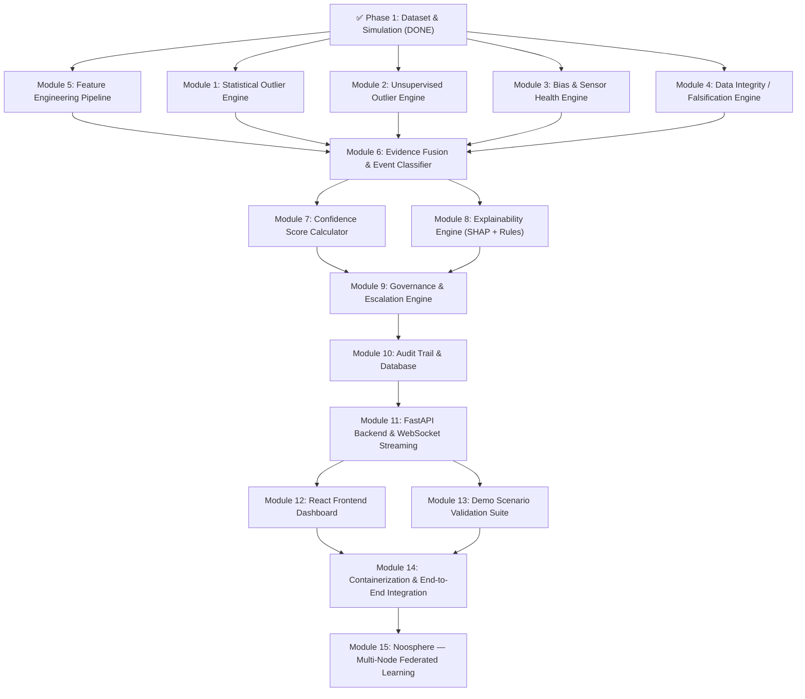

# EnergyMind Tunisia — Execution Plan

> **Module-ordered build plan** for the AI Trust Layer for Energy Systems.
> Each module is listed in strict dependency order — a module can only begin once all its listed prerequisites are complete.

---

## Dependency Map

---

## ✅ Phase 1: Dataset & Simulation — COMPLETE

> Already built and verified in `simulation/` and `data/`.

| Artifact | Location |
|----------|----------|
| Baseline Generator | `simulation/generators/baseline_generator.py` |
| Anomaly Injector (10 types) | `simulation/generators/anomaly_injector.py` |
| Demo Scenarios (A, B, C) | `simulation/scenarios/demo_scenarios.py` |
| Dataset Builder Pipeline | `simulation/dataset_builder.py` |
| Config | `simulation/config/simulation_config.yaml` |
| Clean Baseline (345,600 rows) | `data/raw/baseline_30d.csv` |
| Full Dataset with Anomalies | `data/generated/full_dataset.csv` |
| Ground Truth Labels (134 events) | `data/generated/labels.csv` |
| Engineered Features | `data/processed/features.csv` |
| Train/Val/Test Splits | `data/train/`, `data/val/`, `data/test/` |

**Outputs available for downstream modules:**
- `X_train.csv`, `y_train.csv` — Training features and labels
- `X_val.csv`, `y_val.csv` — Validation features and labels
- `X_test.csv`, `y_test.csv` — Test features and labels
- `features.csv` — Full engineered feature matrix
- `labels.csv` — Complete anomaly ground truth

---

## Phase 2: Detection Engines (Modules 1–5)

> These modules can be developed **in parallel** — they all depend only on Phase 1 outputs.

---

### Module 1: Statistical Outlier Engine

**Directory:** `ml/detectors/statistical/`

| | Details |
|---|---|
| **Purpose** | Detect sudden spikes, gradual shifts, and sustained deviations using classical statistical methods |
| **Tech Stack** | Python, NumPy, SciPy, pandas |
| **Algorithms** | Rolling Z-score, EWMA (Exponentially Weighted Moving Average), CUSUM, Page-Hinkley change detection |
| **Prerequisites** | Phase 1 complete |

| Input | Output |
|-------|--------|
| `data/processed/features.csv` — rolling means, rolling stds, residuals | Per-row anomaly scores: `z_score_voltage`, `z_score_power`, `ewma_alert`, `cusum_alert` |
| `data/raw/baseline_30d.csv` — clean baseline for calibrating thresholds | Statistical alert flags (binary) per timestamp per sensor |
| Raw telemetry columns: `voltage`, `current`, `active_power`, `power_factor` | Drift detection signals (Page-Hinkley statistic values) |

**Key deliverables:**
- `StatisticalDetector` class with `.fit()` (baseline calibration) and `.detect(row)` methods
- Configurable threshold parameters loaded from YAML
- Outputs a `statistical_scores.csv` for offline evaluation

---

### Module 2: Unsupervised Outlier Engine

**Directory:** `ml/detectors/unsupervised/`

| | Details |
|---|---|
| **Purpose** | Identify anomalous patterns without labeled data using density/isolation-based methods |
| **Tech Stack** | scikit-learn (IsolationForest, OneClassSVM), joblib for model persistence |
| **Algorithms** | Isolation Forest (primary), One-Class SVM (secondary) |
| **Prerequisites** | Phase 1 complete |

| Input | Output |
|-------|--------|
| `data/train/X_train.csv` — normal + anomalous features for training | Anomaly score (float) per sample: `isolation_score`, `ocsvm_score` |
| `data/raw/baseline_30d.csv` — clean-only data for training "normal" profile | Binary anomaly label per sample: `is_outlier` |
| Feature columns: rolling stats, residuals, temporal features | Serialized trained models: `isolation_forest.joblib`, `ocsvm.joblib` |

**Key deliverables:**
- `UnsupervisedDetector` class with `.fit()` on clean baseline and `.predict(row)` methods
- Contamination parameter tuning on validation set
- Outputs `unsupervised_scores.csv` for offline evaluation

---

### Module 3: Bias & Sensor Health Engine

**Directory:** `ml/detectors/sensor_health/`

| | Details |
|---|---|
| **Purpose** | Track persistent sensor calibration errors, slow degradation, and peer-compared health scores |
| **Tech Stack** | Python, NumPy, pandas |
| **Algorithms** | Residual analysis (actual vs. historical baseline mean), peer sensor deviation index, exponential health decay scoring |
| **Prerequisites** | Phase 1 complete |

| Input | Output |
|-------|--------|
| `data/processed/features.csv` — `voltage_residual`, `power_residual`, `current_residual` | Per-sensor health score (0–100 scale): `sensor_health_index` |
| `data/raw/baseline_30d.csv` — historical baselines per sensor | Bias detection flags: `persistent_bias_detected`, `bias_magnitude_V` |
| Multi-sensor telemetry for cross-sensor comparison | Neighbor deviation index: `neighbor_deviation` per sensor per timestamp |

**Key deliverables:**
- `SensorHealthTracker` class maintaining rolling per-sensor health state
- Configurable bias detection thresholds (magnitude and duration)
- Cross-sensor consensus calculator (how many peers agree with this sensor's reading)

---

### Module 4: Data Integrity / Falsification Engine

**Directory:** `ml/detectors/integrity/`

| | Details |
|---|---|
| **Purpose** | Detect frozen/stuck values, out-of-bounds corruptions, and replay attacks |
| **Tech Stack** | Python, NumPy, pandas |
| **Algorithms** | Constant-value window detection (zero variance check), out-of-bounds physics validation (V: 180–270V, I: ≥0, PF: 0–1), time-lagged autocorrelation for replay detection |
| **Prerequisites** | Phase 1 complete |

| Input | Output |
|-------|--------|
| Raw telemetry: `voltage`, `current`, `active_power`, `power_factor` | Integrity alert flags: `is_frozen`, `is_corrupted`, `is_replay` |
| `data/raw/baseline_30d.csv` — historical patterns for replay comparison | Replay confidence score (autocorrelation with lagged windows) |
| Physics bounds from `simulation_config.yaml` | Out-of-bounds violation details: `oob_field`, `oob_value` |

**Key deliverables:**
- `IntegrityDetector` class with real-time `.check(row)` method
- Replay detection using sliding-window autocorrelation against past 1–4 hour history
- Configurable freeze duration threshold and physics bounds

---

### Module 5: Feature Engineering Pipeline

**Directory:** `ml/features/`

| | Details |
|---|---|
| **Purpose** | Transform raw telemetry into ML-ready features; acts as the canonical feature extraction step for the classifier |
| **Tech Stack** | Python, pandas, NumPy |
| **Methods** | 15-min rolling means/stds, residual computation, temporal encoding (hour, day-of-week, is_weekend), cross-sensor aggregation |
| **Prerequisites** | Phase 1 complete |

| Input | Output |
|-------|--------|
| Raw telemetry CSV (live stream or batch) | Engineered feature vector per timestamp per sensor |
| `simulation_config.yaml` — rolling window sizes, sensor list | Feature columns: `voltage_rolling_mean_15`, `voltage_rolling_std_15`, `power_rolling_mean_15`, `voltage_residual`, `power_residual`, `current_residual`, `hour`, `day_of_week`, `is_weekend`, `neighbor_deviation_index` |

**Key deliverables:**
- `FeatureExtractor` class with `.transform(raw_df)` method
- Identical logic to what `dataset_builder.py` already uses (refactored into reusable module)
- Supports both batch (DataFrame) and streaming (single-row) modes

> [!NOTE]
> While `dataset_builder.py` already performs feature engineering, this module **refactors** it into a standalone, reusable pipeline class that the backend can call at inference time.

---

## Phase 3: Evidence Fusion & Event Classification (Module 6)

---

### Module 6: Evidence Fusion & Event Classifier

**Directory:** `ml/classifier/`

| | Details |
|---|---|
| **Purpose** | Combine outputs from all 4 detection engines + engineered features into a single multi-class event classification |
| **Tech Stack** | XGBoost (primary), LightGBM / Random Forest (comparison baselines), scikit-learn |
| **Classification Target** | Multi-class: `NORMAL`, `GENUINE_GRID_EVENT`, `DATA_QUALITY_SENSOR_BIAS`, `DATA_QUALITY_SENSOR_DRIFT`, `DATA_QUALITY_SPIKE`, `DATA_QUALITY_DROPOUT`, `DATA_INTEGRITY_FROZEN`, `DATA_INTEGRITY_RANDOM_CORRUPTION`, `FALSIFIED_REPLAY_ATTACK`, `FALSIFIED_BIAS_INJECTION`, `EQUIPMENT_FAULT` |
| **Prerequisites** | **Modules 1, 2, 3, 4, 5** all complete |

| Input | Output |
|-------|--------|
| Engineered features from Module 5 | Predicted event class label |
| Statistical scores from Module 1: `z_score_voltage`, `cusum_alert`, etc. | Class probability distribution (11 classes) |
| Unsupervised scores from Module 2: `isolation_score`, `is_outlier` | Trained model artifact: `event_classifier.joblib` |
| Sensor health from Module 3: `sensor_health_index`, `neighbor_deviation` | Classification report on test set (precision, recall, F1) |
| Integrity flags from Module 4: `is_frozen`, `is_replay`, `is_corrupted` | Cross-sensor agreement ratio per event |
| `X_train.csv` / `y_train.csv` for training | |
| `X_val.csv` / `y_val.csv` for hyperparameter tuning | |
| `X_test.csv` / `y_test.csv` for final evaluation | |

**Key deliverables:**
- `EventClassifier` class with `.train()`, `.predict(features)`, `.predict_proba(features)` methods
- Hyperparameter optimization (grid search or Optuna) on validation set
- Rule-based post-processing: if all 8 sensors show correlated voltage shift → boost `GENUINE_GRID_EVENT` probability
- Confusion matrix and per-class metrics on test set
- Serialized model + feature importance ranking

---

## Phase 4: Trust Layer (Modules 7–8)

---

### Module 7: Confidence Score Calculator

**Directory:** `ml/trust/confidence/`

| | Details |
|---|---|
| **Purpose** | Produce a composite, inspectable confidence score (0–100%) that is **not** just a raw model softmax — it fuses multiple evidence signals |
| **Tech Stack** | Python, NumPy |
| **Method** | Weighted combination of: (1) model class probability, (2) anomaly magnitude, (3) detector consensus count, (4) cross-sensor agreement ratio, (5) historical sensor health index |
| **Prerequisites** | **Module 6** complete |

| Input | Output |
|-------|--------|
| Class probability from Module 6: `predict_proba()` | `composite_confidence_score` (0.0–1.0, displayed as 0–100%) |
| Detector consensus: how many of the 4 engines flagged this event | `confidence_breakdown` dict: individual component scores |
| Cross-sensor agreement ratio from Module 6 | `confidence_level` enum: `HIGH` (≥95%), `MEDIUM` (70–95%), `LOW` (<70%) |
| Sensor health index from Module 3 | |
| Anomaly magnitude (Z-score or deviation size) from Module 1 | |

**Key deliverables:**
- `ConfidenceCalculator` class with `.compute(event_result)` method
- Configurable component weights in YAML
- Score decomposition for transparency (each component's contribution visible)

---

### Module 8: Explainability Engine (SHAP + Rules)

**Directory:** `ml/trust/explainability/`

| | Details |
|---|---|
| **Purpose** | Provide dual explainability: (1) local SHAP feature attributions and (2) rule-backed human-readable natural language justifications |
| **Tech Stack** | SHAP (TreeExplainer for XGBoost), Jinja2 or f-string templates for rule text |
| **Prerequisites** | **Module 6** complete (needs the trained XGBoost model) |

| Input | Output |
|-------|--------|
| Trained XGBoost model from Module 6 | SHAP values per feature per prediction |
| Feature vector for the event being explained | Top-N feature importance ranking for this specific event |
| Event classification result + confidence score | Human-readable explanation string (e.g., *"Voltage offset +9.5V persistent for 45 min; neighbors S-01, S-02, S-04 nominal; grid disturbance probability < 2%"*) |
| Rule templates (YAML/JSON): mapping event types to explanation patterns | SHAP force plot data (for frontend visualization) |

**Key deliverables:**
- `Explainer` class with `.explain(model, features, prediction)` method
- SHAP summary and force plot generation (saved as JSON for frontend)
- Rule-based explanation template library (one template per event type)
- Combined explanation output: `{ shap_values, top_features, rule_explanation, natural_language_summary }`

---

## Phase 5: Governance & Audit (Modules 9–10)

---

### Module 9: Governance & Escalation Engine

**Directory:** `ml/governance/`

| | Details |
|---|---|
| **Purpose** | Route each classified event to the correct action tier based on confidence and risk, with human override capability |
| **Tech Stack** | Python, YAML for threshold configuration |
| **Threshold Tiers** | `AUTO_ACTION` (≥95% confidence & low risk), `OPERATOR_APPROVAL` (70–95%), `MANDATORY_ESCALATION` (<70% or critical event type) |
| **Prerequisites** | **Modules 7 and 8** complete |

| Input | Output |
|-------|--------|
| `composite_confidence_score` from Module 7 | Routing decision: `AUTO_ACTION` / `OPERATOR_APPROVAL` / `MANDATORY_ESCALATION` |
| Event classification from Module 6 | Recommended action string (e.g., "Flag sensor S-03 for calibration inspection") |
| Explanation from Module 8 | Escalation metadata: assigned priority level, SLA timer |
| Governance thresholds from `config/governance.yaml` | Decision record ready for audit logging |

**Key deliverables:**
- `GovernanceEngine` class with `.route(event_result)` method
- Configurable YAML thresholds (non-hardcoded, per the challenge requirements)
- Human override interface: `.override(event_id, operator_decision, comment)`
- Override types: `APPROVE`, `REJECT`, `OVERRIDE_CLASSIFICATION`, `ADD_GROUND_TRUTH`

---

### Module 10: Audit Trail & Database

**Directory:** `backend/db/`

| | Details |
|---|---|
| **Purpose** | Persist every event, decision, explanation, and human override in an immutable, searchable audit log |
| **Tech Stack** | PostgreSQL (production) / SQLite (development), SQLAlchemy ORM, Alembic for migrations |
| **Prerequisites** | **Module 9** complete |

| Input | Output |
|-------|--------|
| Complete event records from the governance engine | Persisted audit rows with: `event_id`, `timestamp`, `sensor_id`, `raw_telemetry_snapshot`, `detection_verdict`, `confidence_score`, `confidence_breakdown`, `shap_explanation`, `rule_explanation`, `model_version`, `triggered_rules`, `recommended_action`, `routing_tier`, `operator_decision`, `operator_comment`, `final_outcome`, `ground_truth_label` |
| Human override actions | Queryable audit history (filter by date, sensor, event type, confidence range) |
| Model version metadata | Compliance export (CSV/JSON dump of filtered audit records) |

**Key deliverables:**
- SQLAlchemy models: `Event`, `Decision`, `AuditEntry`, `OperatorOverride`, `SensorHealth`
- Alembic migration scripts
- Repository pattern: `AuditRepository` class with `.log_event()`, `.query()`, `.export()` methods
- Immutability guarantee: audit entries are append-only, no updates or deletes

---

## Phase 6: Application Layer (Modules 11–12)

---

### Module 11: FastAPI Backend & WebSocket Streaming

**Directory:** `backend/app/`

| | Details |
|---|---|
| **Purpose** | Serve REST API endpoints for data/events/decisions/explanations and provide real-time WebSocket streaming of telemetry + events |
| **Tech Stack** | FastAPI, Uvicorn, WebSockets, Pydantic (request/response models) |
| **Prerequisites** | **Module 10** complete |

| Input | Output |
|-------|--------|
| All ML modules (Modules 1–9) as imported Python packages | REST endpoints: `GET /api/data`, `GET /api/events`, `GET /api/sensors`, `GET /api/decisions`, `GET /api/explanations/{event_id}`, `POST /api/override` |
| Database from Module 10 | WebSocket endpoint: `ws://host/ws/stream` — live telemetry + anomaly events |
| CSV data files (replayed line-by-line to simulate live grid) | Pydantic response schemas for all endpoints |

**Key deliverables:**
- FastAPI app with structured routers (`routers/data.py`, `routers/events.py`, `routers/governance.py`)
- WebSocket streaming simulator: reads CSV row-by-row at configurable speed, runs full pipeline per row, pushes results to connected clients
- CORS configuration for React frontend
- Health check endpoint: `GET /api/health`
- OpenAPI/Swagger auto-documentation

**REST API Endpoints:**

| Method | Endpoint | Description |
|--------|----------|-------------|
| `GET` | `/api/data` | Raw telemetry data (paginated) |
| `GET` | `/api/events` | Detected events (filterable by type, sensor, date, confidence) |
| `GET` | `/api/events/{id}` | Single event detail with full explanation |
| `GET` | `/api/sensors` | All sensor health scores and statuses |
| `GET` | `/api/sensors/{id}` | Single sensor health history |
| `GET` | `/api/decisions` | Governance decisions (pending + resolved) |
| `POST` | `/api/override` | Submit operator override/approval |
| `GET` | `/api/explanations/{event_id}` | SHAP values + rule explanation for event |
| `GET` | `/api/audit` | Audit trail query (with filters) |
| `POST` | `/api/scenarios/{name}/run` | Trigger demo scenario replay |
| `GET` | `/api/health` | System health check |
| `WS` | `/ws/stream` | Real-time telemetry + event stream |

---

### Module 12: React Frontend Dashboard

**Directory:** `frontend/`

| | Details |
|---|---|
| **Purpose** | Operator-facing UI with 7 views for monitoring, investigation, decision-making, and audit |
| **Tech Stack** | React 18+, TypeScript, Recharts / Plotly.js, TailwindCSS, Axios, WebSocket client |
| **Prerequisites** | **Module 11** complete (backend API available) |

| Input | Output |
|-------|--------|
| All REST endpoints from Module 11 | Interactive web application |
| WebSocket live stream from Module 11 | Real-time visualizations |

**Dashboard Views:**

| # | View | Description |
|---|------|-------------|
| 1 | **Command Center** | System overview: total active sensors, current risk score, event counts by type, sensor fleet health summary |
| 2 | **Live Monitoring** | Real-time streaming voltage/power curves with anomaly bands, actual vs. expected overlays |
| 3 | **Event Investigation** | Drill-down view: timeline reconstruction, SHAP bar charts, feature contribution waterfall, cross-sensor comparison |
| 4 | **Sensor Health Map** | Fleet-wide sensor health grid (0–100 scores, color-coded green/yellow/red), historical health trends |
| 5 | **AI Decision Center** | Queue of pending operator approvals, approve/reject/override actions with comment field |
| 6 | **Audit Center** | Searchable, filterable historical log of all events, decisions, and overrides |
| 7 | **Simulation Center** | Scenario replay controls — select Scenario A/B/C, play/pause/speed controls, watch detection in real-time |

---

## Phase 7: Validation & Deployment (Modules 13–14)

---

### Module 13: Demo Scenario Validation Suite

**Directory:** `tests/scenarios/`

| | Details |
|---|---|
| **Purpose** | End-to-end validation using the 3 pre-packaged competition scenarios to prove the system correctly classifies, explains, and routes each case |
| **Tech Stack** | Pytest, requests (API testing) |
| **Prerequisites** | **Module 11** complete (full backend running) |

| Input | Output |
|-------|--------|
| `data/scenarios/scenario_a_genuine_grid_event.csv` | ✅ Verdict: `GENUINE_GRID_EVENT`, Confidence ≥ 95%, Routing: `AUTO_ACTION` |
| `data/scenarios/scenario_b_sensor_bias.csv` | ✅ Verdict: `DATA_QUALITY_SENSOR_BIAS`, Confidence ≥ 90%, Routing: `OPERATOR_APPROVAL` |
| `data/scenarios/scenario_c_falsified_data.csv` | ✅ Verdict: `FALSIFIED_DATA_ATTACK`, Confidence ≥ 90%, Routing: `MANDATORY_ESCALATION` |

**Key deliverables:**
- `test_scenario_a.py`, `test_scenario_b.py`, `test_scenario_c.py`
- Each test: loads scenario CSV → pushes through full pipeline → asserts correct classification, confidence range, explanation content, and governance routing
- Automated regression test: `pytest tests/scenarios/ -v`
- Demo script that runs all 3 scenarios with formatted console output for live presentation

---

### Module 14: Containerization & End-to-End Integration

**Directory:** Project root

| | Details |
|---|---|
| **Purpose** | Package the entire system into Docker containers for reproducible deployment and competition demonstration |
| **Tech Stack** | Docker, Docker Compose, Nginx (frontend serving) |
| **Prerequisites** | **Modules 12 and 13** complete |

| Input | Output |
|-------|--------|
| Backend application (Module 11) | `Dockerfile.backend` |
| Frontend application (Module 12) | `Dockerfile.frontend` |
| Database (Module 10) | `docker-compose.yml` orchestrating: `backend`, `frontend`, `db` (PostgreSQL), `nginx` |
| All ML models and configs | Single command launch: `docker-compose up` |

**Key deliverables:**
- `Dockerfile.backend` — Python 3.11, pip install, uvicorn start
- `Dockerfile.frontend` — Node build stage → Nginx serve stage
- `docker-compose.yml` — Service orchestration with health checks, volume mounts for data, environment variable configuration
- `.env.example` — Environment variable template
- `README.md` — Quick start guide: clone → `docker-compose up` → open `http://localhost:3000`
- End-to-end smoke test script that verifies all services are healthy

---

## Phase 8: Noosphere — Multi-Node Federated Learning (Module 15)

---

### Module 15: Noosphere — Multi-Node Federated Learning

**Directory:** `ml/noosphere/`

| | Details |
|---|---|
| **Purpose** | Enable multiple independent EnergyMind nodes (microgrids, plants, neighborhoods) to share learned anomaly patterns and model improvements without exposing raw data or customer privacy |
| **Tech Stack** | FastAPI (inter-node API), JSON/Protobuf (pattern exchange format), Flower or custom federated averaging |
| **Prerequisites** | **Module 14** complete (single-node system fully working) |

| Input | Output |
|-------|--------|
| Local trained model weights from Module 6 | Federated averaged model weights |
| Local discovered anomaly patterns | Shared Pattern Registry: `PATTERN-XXX` entries (e.g., *"Sensor Bias +5-10% offset, duration 30-60 min"*) |
| Local calibration insights (sensor health baselines) | Cross-node calibration recommendations |
| Privacy boundary: **raw telemetry and customer data NEVER leave the node** | Updated local models incorporating fleet-wide intelligence |

**Key deliverables:**
- `PatternRegistry` — catalog of discovered anomaly signatures with metadata (type, magnitude, duration, frequency)
- `FederatedAggregator` — receives model weight diffs from peer nodes, computes federated average, distributes updated weights
- Inter-node API: `POST /noosphere/share-patterns`, `POST /noosphere/share-weights`, `GET /noosphere/registry`
- Privacy enforcement: middleware that validates no raw telemetry or PII is included in outgoing payloads
- Simulation of 2–3 nodes exchanging patterns in a local Docker network

---

## Summary: Build Order Checklist

| Order | Module | Phase | Status |
|-------|--------|-------|--------|
| — | Dataset & Simulation | Phase 1 | ✅ DONE |
| 1 | Statistical Outlier Engine | Phase 2 | ⬜ |
| 2 | Unsupervised Outlier Engine | Phase 2 | ⬜ |
| 3 | Bias & Sensor Health Engine | Phase 2 | ⬜ |
| 4 | Data Integrity / Falsification Engine | Phase 2 | ⬜ |
| 5 | Feature Engineering Pipeline | Phase 2 | ⬜ |
| 6 | Evidence Fusion & Event Classifier | Phase 3 | ⬜ |
| 7 | Confidence Score Calculator | Phase 4 | ⬜ |
| 8 | Explainability Engine (SHAP + Rules) | Phase 4 | ⬜ |
| 9 | Governance & Escalation Engine | Phase 5 | ⬜ |
| 10 | Audit Trail & Database | Phase 5 | ⬜ |
| 11 | FastAPI Backend & WebSocket Streaming | Phase 6 | ⬜ |
| 12 | React Frontend Dashboard | Phase 6 | ⬜ |
| 13 | Demo Scenario Validation Suite | Phase 7 | ⬜ |
| 14 | Containerization & E2E Integration | Phase 7 | ⬜ |
| 15 | Noosphere — Multi-Node Federated Learning | Phase 8 | ⬜ |

> [!IMPORTANT]
> **Modules 1–5 can be built in parallel** — they all depend only on Phase 1.
> **Modules 7 & 8 can be built in parallel** — they both depend only on Module 6.
> All other modules are strictly sequential.

> [!TIP]
> Start by building Module 5 (Feature Engineering Pipeline) first among the parallel group, since Module 6 (the classifier) will need its output integrated with the detection engines. This gives the detection engine builders a clear target interface.
