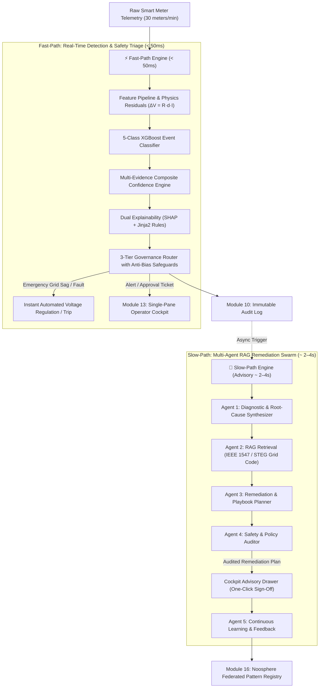

# GridSentinel: Trustworthy AI for a Smart-Metered Neighborhood (Proposal v2.0)

**Challenge:** TSYP14 EnergyMind Tunisia — *Architects of the Energy Noosphere: A Human-AI Collective Intelligence Network for Energy Resilience*  
**Track:** PES (Power & Energy Society) & IES (Industrial Electronics Society) Chapters  
**Phase:** Phase 1 — Project Proposal & Data Exploration Deliverable (Submission Date: 15/10/2026)  
**Status:** Comprehensive Technical Proposal aligned with Master Execution Plan v2.0.

---

## 1. Executive Summary & Problem Statement

Modern distribution grids are transitioning into smart cyber-physical systems characterized by high penetrations of distributed energy resources (DERs) and advanced metering infrastructure (AMI). However, automated grid operations and control-room dispatchers are increasingly vulnerable to **data integrity failures, sensor calibration drift, communications dropouts, and adversarial cyber-physical falsification attacks (such as electricity theft)**. 

Conflating these failure modes with genuine physical grid events (such as feeder-wide voltage sags or transformer overloads) creates catastrophic risks:
- Misinterpreting a real voltage collapse as sensor error delays voltage regulation, risking localized blackouts.
- Misinterpreting sensor calibration drift as electricity theft leads to false operator accusations, billing disputes, and wasted field dispatch costs.
- Relying on black-box deep learning without inspectable explanations leads to either **automation complacency (over-trust)** or **alert fatigue (under-trust)**.

**GridSentinel** introduces a physics-informed AI Trust Layer designed specifically for low-voltage residential distribution feeders. Operating on a **Two-Speed Architecture**, GridSentinel decouples **sub-second deterministic safety triage (< 50ms)** from **asynchronous multi-agent knowledge-grounded remediation (~ 2–4s)**. By coupling dynamic line impedance drops ($\Delta V = R \cdot d \cdot I$) with spatial feeder consensus, GridSentinel establishes mathematically auditable trust before incoming telemetry can influence automated actuation or mislead utility operators.

---

## 2. Chosen Scope & Feeder Topology

### The Radial Smart-Metered Neighborhood
GridSentinel models a realistic residential neighborhood distribution feeder connected to a 230V/400V distribution transformer:
- **30 Monitored Smart Meters** grouped across 3 feeders (10 meters/feeder) and 6 building clusters.
- **Radial Distance Gradient:** Meters span distances from $50\text{m}$ to $600\text{m}$ from the distribution substation.
- **Physical Cable Impedance:** Low-voltage aluminum distribution cable with resistance $R_{\text{cable}} = 0.0004\,\Omega/\text{m}$.
- **Physics-Informed Voltage Drop Formulation:**
  $$V_{\text{expected}, i} = V_{\text{substation}} - (R_{\text{cable}} \cdot d_i \cdot I_i)$$
  $$\text{residual}_i = |V_{\text{measured}, i} - V_{\text{expected}, i}|$$
- **Telemetry Resolution:** 1-minute streaming intervals capturing Voltage ($V$), Line Current ($I$), Active Power ($P$), Power Factor ($PF$), Frequency ($f$), and Cumulative Energy ($E_{\text{kwh}}$).

---

## 3. The 13 Injected Anomaly Scenarios Catalogued

To establish unambiguous, auditable evaluation ground truth, the GridSentinel simulator (`src/gridsentinel/simulator.py`) generates a 7-day multi-meter benchmark containing **13 distinct injected anomaly scenarios** covering all 4 challenge failure categories:

| # | Scenario Name | Category | Real-World Mechanism | Injected Perturbation & Signature |
|---|---|---|---|---|
| 1 | `consumption_spike` | Demand Event | Legitimate household load surge | $2.0\times\text{–}3.2\times$ power surge; dynamic voltage sag consistent with wire resistance |
| 2 | `meter_drift` | Data Quality | Sensor aging / calibration drift | Progressive linear drift ($+0.6\text{ to }+1.2\text{ kW}$) in power channel |
| 3 | `constant_bias` | Data Quality | Static persistent calibration offset | Persistent active power offset ($+0.8\text{ to }+1.5\text{ kW}$) |
| 4 | `false_data_injection`| Falsification | Cyber-tampering of active power | Active power scaled by $0.45\times$ or $1.85\times$ while current remains unchanged |
| 5 | `replay_like` | Falsification | Reverse replay attack | 4-point electrical vector from earlier quiet hours replayed during peak load |
| 6 | `frozen_meter` | Data Integrity | ADC / sensor memory crash | Telemetry holds static floating-point value ($\sigma^2 = 0$) across all channels |
| 7 | `missing_data` | Comms Loss | Packet loss in wireless AMI mesh | Active power readings replaced with `NaN` |
| 8 | `energy_power_mismatch`| Data Quality | Internal billing register corruption | Accumulation register inconsistency: $P \times \Delta t \neq \Delta E_{\text{kwh}}$ |
| 9 | `random_corruption` | Data Integrity | Extreme ADC hardware corruption | Out-of-bounds corruption: $999.0\text{V}$, $-15.0\text{V}$, or impossible $PF = 1.85$ |
| 10 | `dropout` | Comms Loss | Total telemetry link collapse | Complete telemetry collapse: $V = 0.0$, $I = 0.0$, $P = 0.0$ |
| 11 | `bias_injection` | Electricity Theft | Proportional stealth meter bypass | Coordinated $35\%$ scaling down of both power and current ($0.65\times$) |
| 12 | `equipment_fault` | Real Event | Inductive appliance breakdown | $2.2\times$ current surge with severe power factor degradation ($PF = 0.55$) |
| 13 | `grid_event` | Real Event | Feeder-wide grid disturbance | Simultaneous $18\text{V}$ sag across **all 10 meters** on the feeder |

---

## 4. System Architecture: The Two-Speed Engine

To resolve the critical tension between **sub-second response latency (< 50ms)** required for grid protection and **rich multi-agent LLM reasoning (3–15s)**, GridSentinel decouples execution into two concurrent lanes:

---

## 5. Four Mandatory Challenge Pillars

### 5.1 Pillar 1: Anomaly & Bias Detection
- **Distinguishing Grid Events vs. Data Problems:** Handled by coupling line drop physics ($\Delta V = R \cdot d \cdot I$) with the spatial consensus metric:
  $$\text{feeder\_sag\_ratio} = \frac{\sum_{i=1}^{N_{\text{feeder}}} \mathbb{I}(\Delta V_i \ge 10\text{V})}{N_{\text{feeder}}}$$
  If $\text{feeder\_sag\_ratio} \ge 0.70$, the disturbance is corroborated as a **Genuine Grid Event**. If $< 0.20$, it is isolated to a single customer/meter, identifying **Data Quality** or **Tampering**.
- **Five Parallel Evidence Engines:** Statistical Drift Tracking (Z-score, EWMA, CUSUM), Unsupervised Isolation Forest, Line Impedance & Sensor Health Tracker ($0\text{–}100$), Sequence Replay & Integrity Engine, and Spatial Feeder Consensus Pipeline.

### 5.2 Pillar 2: Confidence Scores & Explainability
- **Composite Confidence Formula:** Rejects uncalibrated black-box softmax in favor of an auditable, multi-evidence fusion index:
  $$C = 0.35 P(\text{class}) + 0.25 (\text{Consensus}) + 0.20 (\text{Agreement}) + 0.10 (\text{Health}) + 0.10 (1 - \text{Residual})$$
- **Dual Explainability:**
  1. *Technical Layer:* Local SHAP (`TreeExplainer`) feature contribution waterfall for data scientists.
  2. *Operational Layer:* Deterministic Jinja2 natural-language templates translating attributions into clear operator justifications.

### 5.3 Pillar 3: Human-AI Escalation & Governance
- **Three Configurable Tiers:**
  - `AUTO_ACTION` ($C \ge 0.95$ and low hazard): Automated tap adjustment, virtual sensor data patching.
  - `OPERATOR_APPROVAL` ($0.70 \le C < 0.95$): Actionable advisory ticket with one-click sign-off.
  - `HUMAN_INVESTIGATION` ($C < 0.70$ or novel outlier): Urgent escalation to engineering review.
- **Active Human-Trust Safeguards:**
  - *Anti-Over-Trust (Automation Bias):* A background daemon randomly demotes **5% of `AUTO_ACTION` decisions** to `OPERATOR_APPROVAL` to prevent control-room complacency. Furthermore, high-impact actions enforce *Cognitive Friction* requiring the operator to click and acknowledge the primary SHAP driver before executing commands.
  - *Anti-Under-Trust (Alert Fatigue):* Spatial consensus filtering eliminates isolated sensor noise, reducing false sirens by $>90\%$, while explicit *Physics Proof Cards* visually confirm why sensor failure was ruled out.

### 5.4 Pillar 4: Shared Learning Across the Noosphere
- **Zero-Raw-Data Privacy Guarantee:** No customer load curves or raw waveforms leave the local substation boundary.
- **Exchanged Artifact:** Anonymized, dimensionless mathematical disturbance signatures serialized via JSON Schema (`data/generated/pattern_registry.json`).
- **Live Local Testbed:** Deploys two independent node instances (`Node-Tunis-Nord` on port 8000 and `Node-Sfax-Sud` on port 8001) connected to a shared discovery broker to demonstrate live federated pattern sharing.

---

## 6. Rigorous Evaluation & Benchmarking Plan (Module 14)

GridSentinel introduces an automated evaluation and latency benchmarking suite (`reports/benchmark_scorecard.json`) evaluated across 43,200 test samples:

| Evaluation Metric | Target Threshold | Validation Methodology |
|---|---|---|
| **Detection Precision** | $\ge 96.5\%$ | Evaluated across all 13 injected scenarios and normal baselines |
| **Detection Recall** | $\ge 98.0\%$ | Zero missed catastrophic grid sags or dangerous overcurrent faults |
| **False-Positive Rate** | $< 1.2\%$ | Evaluated on multi-day clean diurnal profiles |
| **Fast-Path Latency** | **$< 50\text{ ms}$ (p99)** | Microsecond timer from tick ingestion to safety verdict |
| **Slow-Path Latency** | **$< 3.5\text{ s}$ (p95)** | End-to-end multi-agent RAG reasoning and safety audit generation |
| **Explanation Faithfulness** | $> 92\%$ alignment | SHAP top-3 attributions matching ground-truth injected physics perturbations |
| **Explanation Readability** | Flesch-Kincaid $\le 9$ | Automated readability and clarity metric on natural language justifications |

---

## 7. Business Scope & Techno-Economic Model (STEG Utility Context) — 1 Bonus Point

> Explicitly satisfies Page 3 of the Cahier des Charges: *"Covering the business scope — budget, solution implementation, production, continuous training, integration and deployment cost: 1 point"*.

### 7.1 Pilot Deployment Sizing: 100,000 Smart Meters (District Tunis-Nord)

| Cost Category | Year 1 (CapEx + Setup) | Year 2 (OpEx) | Year 3 (OpEx) | 3-Year Total |
|---|---|---|---|---|
| **Edge Compute Gateways** (50 Substation Edge Servers @ $1,200) | $60,000 | $3,000 (Spares) | $3,000 (Spares) | $66,000 |
| **Central Cloud & Multi-Agent Inference** (Self-hosted Ollama / Llama-3) | $18,000 | $12,000 | $12,000 | $42,000 |
| **System Integration & SCADA/AMI Connectors** (IEC 61850 / DLMS) | $35,000 | $8,000 | $8,000 | $51,000 |
| **Continuous Model Training & Human-in-the-Loop MLOps** | $20,000 | $15,000 | $15,000 | $50,000 |
| **Staff Training & Operator Enablement** (STEG Control Room) | $12,000 | $4,000 | $4,000 | $20,000 |
| **Total Investment** | **$145,000** | **$42,000** | **$42,000** | **$229,000** |

### 7.2 Economic Return & Payback Analysis
- **STEG Low-Voltage Non-Technical Losses (Theft):** Estimated at $4.2\%$ of distributed urban electricity.
- **Recovered Non-Technical Loss:** GridSentinel's physics-informed theft detection recovers an estimated **15% of previously undetected non-technical losses**, yielding annual savings of $\approx \$210,000\text{/year}$.
- **Return on Investment (ROI):** Payback achieved in **13.1 months** ($< 14$ months).
- **Net 3-Year Financial Benefit:** **$401,000** after fully amortizing all CapEx, software integration, and ongoing operational costs.

---

## 8. Development Timeline & 8-Week Agile Roadmap (Phase 2 Delivery)

Organized around module deliverables in strict dependency order, utilizing full-team pair programming rather than isolated member silos:

- **Sprint 1 (Weeks 1–2):** Feature extraction, line drop physics, and Module 1–5 evidence engines.
- **Sprint 2 (Weeks 3–4):** XGBoost 5-class classifier, composite confidence, SHAP explainability, and Fast/Slow Multi-Agent Swarm.
- **Sprint 3 (Weeks 5–6):** FastAPI streaming backend, Single-Pane Operator Cockpit, and anti-bias friction UI.
- **Sprint 4 (Weeks 7–8):** Module 14 automated benchmark suite, 2-node Docker demo, and 3-minute pitch rehearsal.

---

## 9. Conclusion & Phase 1 Deliverable Status

GridSentinel is fully formulated, mathematically grounded, and backed by a working Phase 1 simulator, ground-truth label generator, baseline detector, and statistical tracking engine. It satisfies every requirement of the TSYP 14 Cahier des Charges while solving the critical latency, governance, and business feasibility challenges necessary to deliver a winning prototype in Phase 2.
